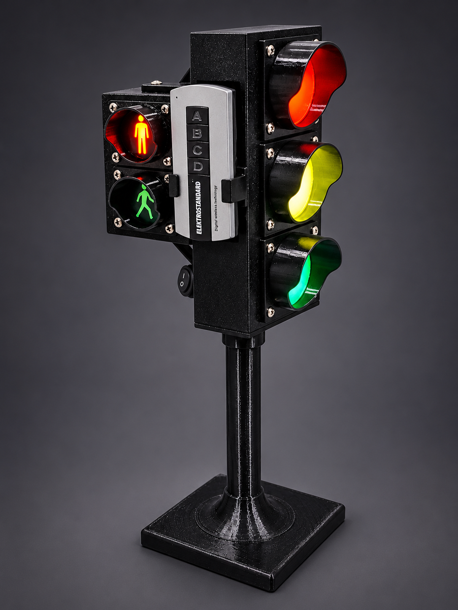

# Arduino-Traffic-Light
ATmega8-based interactive traffic light with 433 MHz remote control, automatic operation and pedestrian crossing.
# 🚦 Arduino Traffic Light

An interactive 3D-printed traffic light with pedestrian signals, automatic operation and wireless remote control.

The project is based on an ATmega8 microcontroller and a 433 MHz RF remote.

## Features

- Automatic traffic light operation.
- Wireless remote control (433 MHz).
- Separate vehicle and pedestrian signals.
- Flashing green signals before switching.
- Adjustable timing intervals.
- Non-blocking operation using `millis()`.
- Automatic mode starts on power-up.

## Hardware

- ATmega8 microcontroller
- 433 MHz RF receiver
- 433 MHz remote control
- SS8050 NPN transistors
- LED signal modules
- 3D-printed enclosure

## Pin Configuration

| Arduino Pin | Function |
|---|---|
| D2 | 433 MHz DATA |
| D5 | Main Red |
| D6 | Main Yellow |
| D7 | Main Green |
| D8 | Pedestrian Red |
| D9 | Pedestrian Green |

## Remote Control

| Button | Function |
|---|---|
| A | Main Red + Pedestrian Green |
| B | Main Yellow |
| A + B | Main Red + Yellow |
| C | Main Green + Pedestrian Red |
| D | Automatic Mode |

**RF protocol:** RC-Switch Protocol 1, 24-bit.

## Automatic Operation

1. Main red + pedestrian green.
2. Pedestrian green starts flashing.
3. Pedestrian green turns off.
4. Main red + yellow.
5. Main green + pedestrian red.
6. Main green starts flashing.
7. Main yellow.
8. Main red + pedestrian red.
9. The cycle repeats.

## Timing Configuration

All timing intervals can be adjusted in the beginning of the `.ino` sketch.

## Software

- Arduino IDE
- RCSwitch library

## 3D Model

The 3D model, printing profiles and assembly instructions will be published on MakerWorld.

## License

This project is licensed under the MIT License.
